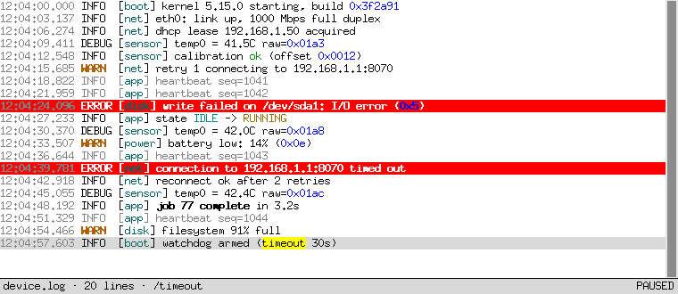

# xlgr

`xlgr` is a small X11 log message viewer in the style of `xload`, `xdf` and
`xmem`. It shows log lines from a file, standard input, a serial port or a
telnet connection, with regex highlighting rules, a scrollbar and a cursor.
Lines are kept in memory (100,000 by default; up to 100,000,000 with
`-scrollback`) and the oldest are dropped when the limit is reached.



*A sample log using `xlgr.rules.example`-style rules, with ANSI colours, a
search for `timeout` and the cursor line selected.*

Build it with `make` (a C compiler and Xlib development files are required),
then run:

```sh
./xlgr app.log                         # shows the file, then follows it like tail -f
some_command | ./xlgr -                # standard input
./xlgr -serial /dev/ttyUSB0            # 115200 8N1; reconnects if the device goes away
./xlgr -serial /dev/ttyUSB0 -baud 921600 -serialmode 8N1 -flow rtscts
./xlgr -telnet 192.168.1.50:8070       # reconnects if the connection drops
./xlgr app.log -scrollback 1000000 -font 9x15 -rules ~/my.rules
```

Options: `-serial`, `-baud`, `-serialmode`, `-flow`, `-telnet`, `-file`,
`-scrollback`, `-rules`, `-rule`, `-norules`, `-noansi`, `-font`, `-display`,
`-geometry` (in pixels), `-fg`/`-foreground`, `-bg`/`-background` and
`-hl`/`-highlight` (cursor line colour) and `-sel`/`-selection` (selected
lines, default `#c6dcff`). Run `./xlgr -help` for a summary.

## Keys and mouse

| Input | Action |
|---|---|
| Up/Down, `k`/`j` | move the cursor line (starts at the edge of the view) |
| PgUp/PgDn | scroll a page (moves the cursor if it is shown) |
| mouse wheel | scroll 3 lines (1 with Shift); scrolling to the bottom resumes following |
| scrollbar | drag the thumb, or click the trough to page |
| click a line | put the cursor on it |
| drag | select whole lines from the line where you pressed to the line under the pointer (any part of a line selects all of it); dragging past the top or bottom scrolls |
| Shift+click | extend the selection to the clicked line |
| Esc | clear the selection (then the search, then the cursor) |
| Home/`g`, End/`G` | top of the buffer; newest line and follow |
| space | pause or resume following |
| Left/Right | scroll sideways 8 columns |
| `/` text, Enter | regex search (Esc clears); `n`/`N` next/previous |
| `f` text, Enter | show only lines matching a regex; an empty filter clears it |
| Enter or `c` | copy the selection (or the cursor line, or the newest) to PRIMARY and CLIPBOARD |
| `w` | write the visible lines to a file (prompts for the name) |
| `C` | clear the buffer |
| `q` | quit |

Selections are always whole lines and are made of the text only, without
colours. Releasing the mouse after a drag makes the selection available to
middle-click paste (PRIMARY); Enter or `c` also puts it on CLIPBOARD for
Ctrl+V. With a filter active, only the visible lines are selected, and
changing the filter clears the selection.

Search and filter patterns are POSIX extended regexes and ignore case unless
the pattern contains an upper-case letter. The status line shows the source,
its connection state, the line count, the active search or filter, and
FOLLOW or PAUSED. Moving the cursor up or scrolling back pauses following.

## Highlighting rules

Rules come from `-rules file`, otherwise from `$XDG_CONFIG_HOME/xlgr/rules`,
`~/.config/xlgr/rules` or `~/.xlgr.rules`, plus any `-rule` options. With none
of those, a few built-in rules colour errors, warnings and hex numbers; use
`-norules` to turn all rules off. The file is re-read when it changes, so you
can tune it while a log is streaming. See `xlgr.rules.example`.

```
/regex/[i]  fg=COLOR bg=COLOR bold underline strike dim group=N line   # comment
```

- The regex is POSIX extended (use `[0-9]`, not `\d`; GNU `\<` `\>` `\b` work).
  A trailing `i` makes it case-insensitive.
- `fg`/`bg` take X colour names or `#rrggbb`.
- `group=N` colours only parenthesised group N instead of the whole match.
- `line` colours the whole line if the regex matches anywhere.
- `strike` draws a line through the text; `dim` fades the text colour towards
  the background.
- Each property (fg, bg, styles) is taken from the first rule that sets it, so
  put specific rules first.

## Input handling

## ANSI colours

SGR escape sequences in the log are shown as colours and styles: the 8 and 16
standard colours (`30-37`, `90-97`, `40-47`, `100-107`), 256-colour
(`38;5;n`) and truecolour (`38;2;r;g;b`) foregrounds and backgrounds, bold,
dim, underline, strikethrough and reverse. A style carries onto following
lines until reset. The 16 standard colours use a palette that is readable on a
light background, or the usual xterm colours when `-bg` is dark. Highlighting
rules take priority over ANSI colours where both set the same property, and
search matches override both.

Everything else is removed without trace: cursor movement, erase and
scrolling sequences, private modes, save/restore cursor, character-set
selection (`ESC ( B`), and string sequences such as window titles and
hyperlinks (OSC), DCS and APC, which end at BEL or `ESC \\`. The text of a
hyperlink is kept. The bell is dropped. A control character, such as a
newline, ends an unfinished escape sequence, so a stray ESC cannot swallow a
line break. Italic, blink, conceal and underline colours are ignored. Use
`-noansi` to strip all escape sequences without colouring.

## Input handling

## ANSI colours

SGR escape sequences in the log are shown as colours and styles: the 8 and 16
standard colours (`30-37`, `90-97`, `40-47`, `100-107`), 256-colour
(`38;5;n`) and truecolour (`38;2;r;g;b`) foregrounds and backgrounds, bold,
underline and reverse. A style carries onto following lines until reset. The
16 standard colours use a palette that is readable on a light background, or
the usual xterm colours when `-bg` is dark. Highlighting rules take priority
over ANSI colours where both set the same property, and search matches
override both. Other escape sequences (cursor movement and so on) are
removed. Use `-noansi` to strip all escape sequences without colouring.

## Input handling

Lines end at LF, CRLF or a lone CR. A line is shown as soon as its first
character arrives, so prompts without a newline are visible. Tabs expand to 8
columns, other control characters show as
`.`, and UTF-8 is converted to Latin-1 for the core X font (characters outside
Latin-1 show as `?`). Lines over 4096 characters are split. Telnet option
negotiation is handled; every option except ECHO and SGA is refused.

The window sets its own icon (`_NET_WM_ICON`). GNOME ignores that and looks up
a desktop entry matching `WM_CLASS`; run `make install` to install the binary,
`xlgr.desktop` and `xlgr.svg` under `~/.local` (or set `PREFIX`), then restart
xlgr.

## Tests

`make test` builds and runs the tests; no X server is needed. `tests/test_xlgr.c`
includes `xlgr.c` and unit-tests the line ingest (line endings, UTF-8, tabs,
ANSI styles, telnet negotiation), the scrollback ring, filter, search, view
and cursor logic, rule parsing and buffer writing. `tests/cli.sh` checks
command-line handling and error messages. To run them under the sanitizers:

```sh
make test CFLAGS="-g -O1 -fsanitize=address,undefined" LDFLAGS="-fsanitize=address,undefined"
```
